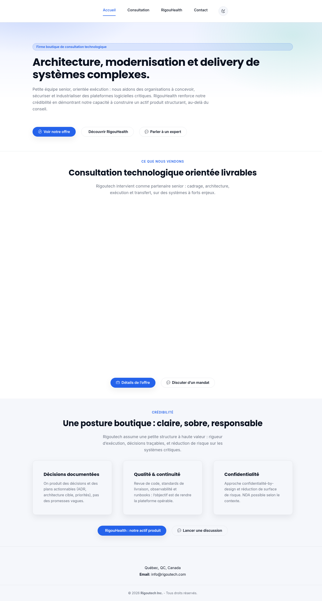
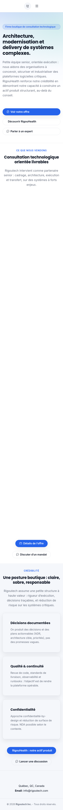

# Audit du site rigoutech.com

Date : 27 octobre 2026.
Site regardé : https://rigoutech.com (tel qu’il est en ligne, dernière modification indiquée par le serveur : 10 août 2026).
Code regardé : le dépôt qui alimente GitHub Pages, avant la refonte proposée dans cette même branche.
Public visé : des PME et des partenaires au Québec. La langue attendue est le français.

Ce document est écrit pour une lecture sans bagage de web. Les captures plus bas montrent le site réel, pas une maquette.

## En une minute

Le site s’affiche, il est en français, et le courriel info@rigoutech.com est cohérent. Il ne ressemble pas pour autant au cabinet que Rigoutech est aujourd’hui.

Un dirigeant de PME qui arrive sur la page d’accueil lit un texte de firme « boutique » sur les systèmes critiques, puis une page produit (RigouHealth) qui parle d’urgences hospitalières et cite le CHUM comme exemple. Il ne voit ni la journée de formation, ni le diagnostic Microsoft 365 / Exchange, ni la revue de coûts Azure.

Il ne voit pas non plus qui répond (Cedric Kouma), ni de politique de confidentialité. Au Québec, la Loi 25 exige cette politique dès qu’on recueille un nom et un courriel. Le formulaire de contact le fait, sans le dire clairement.

À côté de ça, des fichiers de travail sont publics : une notice de template BootstrapMade qui invite à « acheter la version pro », et des notes internes qui déclarent le site « prêt pour la production ».

## Captures du site en ligne (avant)

Page d’accueil complète, écran d’ordinateur (largeur 1440). Le menu est centré, sans logo. Le texte vend de l’architecture et RigouHealth.

Même page, téléphone (largeur 390). Le menu se replie derrière un bouton, la page devient très longue, et le nom de l’entreprise n’apparaît pas en haut.

J’ai aussi ouvert les pages Consultation, RigouHealth et Contact. Le constat est le même : quatre adresses (accueil, `rd.html`, `produits.html`, `contact.html`), un seul discours, et aucune des offres réellement vendues.

## Constats, du plus grave au plus léger

Chaque point indique ce qu’une personne extérieure risque de conclure, puis un correctif court.

### 1. Critique — Le site ne présente pas les services réellement vendus

La page d’accueil dit : « Architecture, modernisation et delivery de systèmes complexes », « petite équipe senior », « plateformes logicielles critiques ». La page Consultation (`rd.html`) répète architecture, CI/CD, observabilité. La page RigouHealth (`produits.html`) décrit une plateforme qui « anticipe la charge hospitalière » et donne « un exemple de périmètre : CHUM (Montréal) ».

Aucune de ces pages ne mentionne :

- la journée « IA générative et cybersécurité au travail » (7 h, jusqu’à 12 personnes, modules Loi 25 et hameçonnage par IA, module Copilot optionnel) ;
- le diagnostic Microsoft 365 / Exchange, en lecture seule, lié au retrait d’EWS en 2027 ;
- le conseil Azure, DevOps, automatisation, et les revues de coûts Azure ;
- le mandat Excelsoins (janvier à mars 2026, Pointe-Claire).

Une PME qui cherche une formation ou un diagnostic Microsoft ne se reconnaît pas. Une personne prudente peut aussi croire que le CHUM est un client, alors que ce n’est pas une référence que l’on peut citer.

Correctif : réécrire le site autour des trois offres réelles, et retirer RigouHealth et le CHUM du site corporate. Le produit peut rester à sa propre adresse.

### 2. Critique — Il manque la politique de confidentialité exigée par la Loi 25

Le formulaire de contact demande le nom, le courriel, un profil et un message. Ça, c’est un renseignement personnel.

Il n’existe aucune page « politique de confidentialité ». Le responsable de la protection des renseignements personnels n’est pas nommé. Rien n’explique pourquoi ces renseignements sont demandés, combien de temps ils sont gardés, ni comment écrire pour y accéder ou les faire corriger. Il n’y a pas de case de consentement.

En plus, chaque page charge des polices depuis Google (Inter et Poppins). L’adresse IP du visiteur part donc chez Google, sans que le site le dise. Ce n’est pas un outil de statistique, mais c’est quand même un tiers.

Point positif à conserver : il n’y a pas de Google Analytics, ni de publicité, ni de témoin de suivi déposé par le site. Le choix du thème clair/sombre est seulement mémorisé dans le navigateur (localStorage), pas envoyé à Rigoutech.

Correctif : une politique en français simple, qui nomme Cedric Kouma, décrit le formulaire, dit qu’il n’y a pas de mesure d’audience, et une case d’accord avant l’envoi. Arrêter d’appeler Google pour les polices.

### 3. Élevé — Le texte suggère une équipe et des preuves que le site n’a pas

« Petite équipe senior », « parler à un expert », « RigouHealth renforce notre crédibilité », « ce que RigouHealth prouve ». Cedric Kouma est le seul propriétaire. La seule référence vérifiable qu’on peut écrire est Excelsoins, sans citation, sans nombre de participants et sans témoignage.

Le site n’invente pas de faux logos clients, et c’est bien. Le problème est dans les formulations, qui font plus gros que la réalité.

Correctif : parler de Rigoutech Inc. et nommer Cedric Kouma. Décrire Excelsoins comme un fait. Retirer le registre « preuve » et « équipe ».

### 4. Élevé — On ne sait pas qui répond, et une mauvaise adresse tombe sur GitHub

Le pied de page dit seulement « Québec, QC, Canada » et info@rigoutech.com. Pas de nom, pas de téléphone, pas d’adresse civique. Pour une PME, un site sans personne identifiable est plus difficile à croire, surtout à côté d’un discours très ambitieux.

Une adresse inconnue (essai du 27 octobre 2026) affiche la page anglaise de GitHub, « Page not found », avec le logo GitHub. Ce n’est pas une page de Rigoutech.

Correctif : nom et courriel sur chaque page, page 404 en français. Ne pas inventer un téléphone ni une rue : les noter comme éléments à fournir par Cedric.

### 5. Élevé — Des restes de template et des notes internes sont en ligne

Ces adresses répondent, aujourd’hui, avec un code 200 :

- https://rigoutech.com/forms/Readme.txt — texte BootstrapMade : « Fully working PHP/AJAX contact form script is available in the pro version », avec un lien pour acheter le thème.
- https://rigoutech.com/REFACTORING_SUMMARY.md — note interne du 27 janvier 2026 qui dit « Production Ready » et « WCAG 2.1 Level AA ».
- https://rigoutech.com/REFACTORING_NOTES.md — même famille de notes, y compris une idée d’ajouter de l’analytique.
- https://rigoutech.com/assets/vendor/bootstrap-icons/index.html — galerie d’icônes du template (160 Ko).
- https://rigoutech.com/package.json et `eslint.config.mjs` — fichiers d’outillage.

Un prospect qui tombe là-dessus voit un thème acheté et des notes de chantier, pas un cabinet.

Correctif : ne plus publier ces fichiers.

### 6. Moyen — L’apparence est celle d’un thème, et la marque est mal servie

Le menu du haut n’affiche pas le logo. Le logo n’est que dans le pied de page. Les deux fichiers « bannière » clairs et foncés sont tous les deux dans la page ; un seul se voit.

Les icônes d’onglet (favicon) portent des noms « 16x16 », « 32x32 », « 180x180 », « 512x512 », mais les images sont des bandeaux écrasés : 16×5, 32×11, 180×64, 512×183 pixels. Dans l’onglet du navigateur, le symbole est illisible.

Le dessin général (dégradé bleu et vert, cartes identiques, deux familles de polices) ressemble à un thème générique. Les fichiers de logo inutilisés pèsent lourd : `logo-banner-light.png` fait 1,0 Mo, `short logo light background.png` 948 Ko, et les noms contiennent des espaces.

Correctif : logo lisible dans l’en-tête, vraies icônes carrées, une seule famille de caractères déjà présente sur l’ordinateur du visiteur, et suppression des images inutiles.

### 7. Moyen — Le référencement de base est commencé, pas fini pour une entreprise locale

Ce qui est déjà en place :

- une balise `title` et une description sur les pages principales ;
- un lien canonique sur ces pages ;
- un fichier `robots.txt` qui pointe vers le sitemap ;
- un `sitemap.xml` avec les quatre pages actuelles ;
- la langue `fr` sur la page.

Ce qui manque pour qu’un moteur, ou un partage LinkedIn, comprenne qu’il s’agit d’une entreprise du Québec :

- aucune donnée structurée (le bloc que les moteurs lisent pour une entreprise locale : nom, zone desservie, courriel). Le code est « prêt pour un schéma », le schéma n’est pas là ;
- les balises de partage (Open Graph) ne sont que sur l’accueil. L’image de partage est le logo en 320 pixels de large, pas une image au format attendu (environ 1200×630) ;
- la description d’accueil vend encore RigouHealth ;
- la langue est `fr`, pas `fr-CA` ;
- pas de page anglaise, même courte, pour un partenaire qui ne lit pas le français. Ce n’est pas une obligation, c’est un manque si des partenaires sont anglophones.

Correctif : titres et descriptions alignés sur les vraies offres, données structurées sans adresse inventée, image de partage correcte, `fr-CA`, sitemap à jour, une page anglaise courte.

### 8. Moyen — Accessibilité : de bonnes bases, des trous concrets

Ce qui tient :

- zones de page (en-tête, contenu, pied) ;
- champs du formulaire associés à une étiquette ;
- bouton de menu mobile avec un nom et un état (`aria-expanded`). Vérifié le 27 octobre 2026 à 390 pixels de large : le menu est masqué, le bouton s’affiche, la page ne déborde pas sur le côté ;
- un style au clavier (`:focus-visible`) existe dans la feuille de styles ;
- le logo du pied de page a un texte de remplacement.

Ce qui cloche :

- un lien « aller au contenu » est prévu dans la CSS (`.rt-skip-link`) mais il n’est dans aucune page. Quelqu’un qui navigue au clavier doit traverser tout le menu à chaque page ;
- le gris des textes secondaires (`#6b7280`) fait environ 4,8:1 sur blanc, ce qui passe, mais environ 4,3:1 sur le fond bleuté du bandeau (`#eef2ff`). Le seuil usuel pour du texte courant est 4,5:1. Une partie du texte d’introduction est donc trop pâle ;
- l’année du copyright est vide si JavaScript ne tourne pas : elle n’est écrite que par un script ;
- une librairie d’animation (AOS, animations d’une seconde) est chargée partout. La CSS raccourcit les animations si la personne a demandé « moins de mouvement » dans son système, mais le script les lance quand même.

Correctif : remettre le lien d’évitement, assombrir le texte secondaire, écrire l’année dans le HTML, retirer les animations.

### 9. Moyen — La page n’est pas lourde, mais elle gaspille et appelle un tiers

Mesure du 27 octobre 2026, Chrome, premier affichage de l’accueil :

- le HTML pèse 14 Ko (environ 3,6 Ko une fois compressé par le serveur) ;
- l’ensemble HTML + CSS + JavaScript + police d’icônes transféré tourne autour de 135 Ko ;
- la police d’icônes Bootstrap, à elle seule, fait 85 Ko, pour une poignée d’icônes ;
- Google Fonts ajoute une requête vers Google, puis au moins un fichier de police Inter ;
- cinq feuilles de styles et deux scripts s’ajoutent, plus un préchargeur (l’écran d’attente) qui ne sert à rien sur un site de texte.

Les images réellement affichées sont raisonnables (logo du pied de page : 35 Ko). Le problème de poids est surtout ce qui est publié sans être montré : jusqu’à 1 Mo pour un PNG de logo.

Correctif : polices du système, plus de librairie d’icônes, suppression des images inutiles, logo compressé.

### 10. Moyen — Les en-têtes de sécurité ne peuvent pas être choisis sur GitHub Pages

Un en-tête de sécurité est une consigne que le serveur envoie au navigateur avant la page : ne pas se laisser encadrer par un autre site, forcer le HTTPS, limiter d’où viennent les scripts, etc.

Sur la page d’accueil, la réponse du 27 octobre 2026 contient : `server: GitHub.com`, `access-control-allow-origin: *`, et c’est à peu près tout. Il n’y a pas de Content-Security-Policy, pas de Strict-Transport-Security (HSTS), pas de X-Content-Type-Options, pas de Referrer-Policy. Le cadenas HTTPS, lui, est bien là : GitHub le fournit avec le domaine rigoutech.com.

GitHub Pages ne permet pas d’ajouter ces consignes. Un fichier `_headers` (utilisé chez d’autres hébergeurs) est ignoré. On peut seulement mettre une partie de la politique dans la page elle-même (balise meta). Ça couvre les scripts et les styles. Ça ne remplace pas HSTS, ni l’interdiction d’afficher le site dans une iframe (`frame-ancestors` est ignoré dans une balise meta).

Correctif réaliste : ajouter dans le HTML ce qui peut l’être (politique de contenu, referrer), ne charger aucun script tiers, et accepter la limite de GitHub Pages. Un service placé devant le site (par exemple Cloudflare) serait nécessaire pour de vrais en-têtes. Ce n’est pas fait ici : ça demanderait un compte et un changement d’infrastructure.

Le formulaire n’a pas de serveur derrière lui. Il ouvre le logiciel de courriel du visiteur. Il n’y a donc pas de base de données à vider. Le « pot de miel » anti-robot ne protège que le navigateur, ce qui est cohérent avec ce choix.

### 11. Faible — Liens, anciennes adresses, contenu périmé

- Pas de faux texte « lorem ipsum ».
- Pas d’année figée et fausse dans le texte visible. L’année du bas de page est calculée.
- `facturx/` redirige vers https://agentforge.rigoutech.com/factur-x (la page répond). Ce n’est pas un lien mort. C’est un autre produit, qui n’a pas sa place comme offre corporate, mais l’ancienne adresse doit continuer de mener quelque part.
- https://rigouhealth.rigoutech.com/fr répond aussi. Même remarque : site à part, à ne plus mettre en vitrine ici.
- L’adresse `rd.html` ne veut rien dire pour un visiteur (« R et D » ?). `produits.html` n’est pas un catalogue.
- Le formulaire ne dit qu’après le clic que le logiciel de courriel doit s’ouvrir.

Correctif : garder une redirection courte pour les anciennes adresses, expliquer le fonctionnement du formulaire avant l’envoi, retirer le discours produit du site vitrine.

## Ce qui ne pose pas problème

- Le domaine répond en HTTPS.
- Le fichier `CNAME` contient `rigoutech.com`. Il faut le garder pour le domaine personnalisé.
- Le site est du HTML statique, compatible avec GitHub Pages. La refonte doit le rester.
- Le courriel info@rigoutech.com est le seul moyen de contact publié. Il est repris tel quel.
- Le menu mobile fonctionne (vérifié dans le navigateur, pas seulement dans la CSS).
- Il n’y a pas de traceur publicitaire à retirer.

## Ordre de travail retenu

1. Dire la vérité sur l’offre, la personne et la référence Excelsoins.
2. Publier la politique de confidentialité et nommer Cedric Kouma.
3. Enlever les fichiers de template et les notes internes.
4. Remettre une marque lisible, une page 404, et un partage correct.
5. Alléger la page et couper l’appel à Google.
